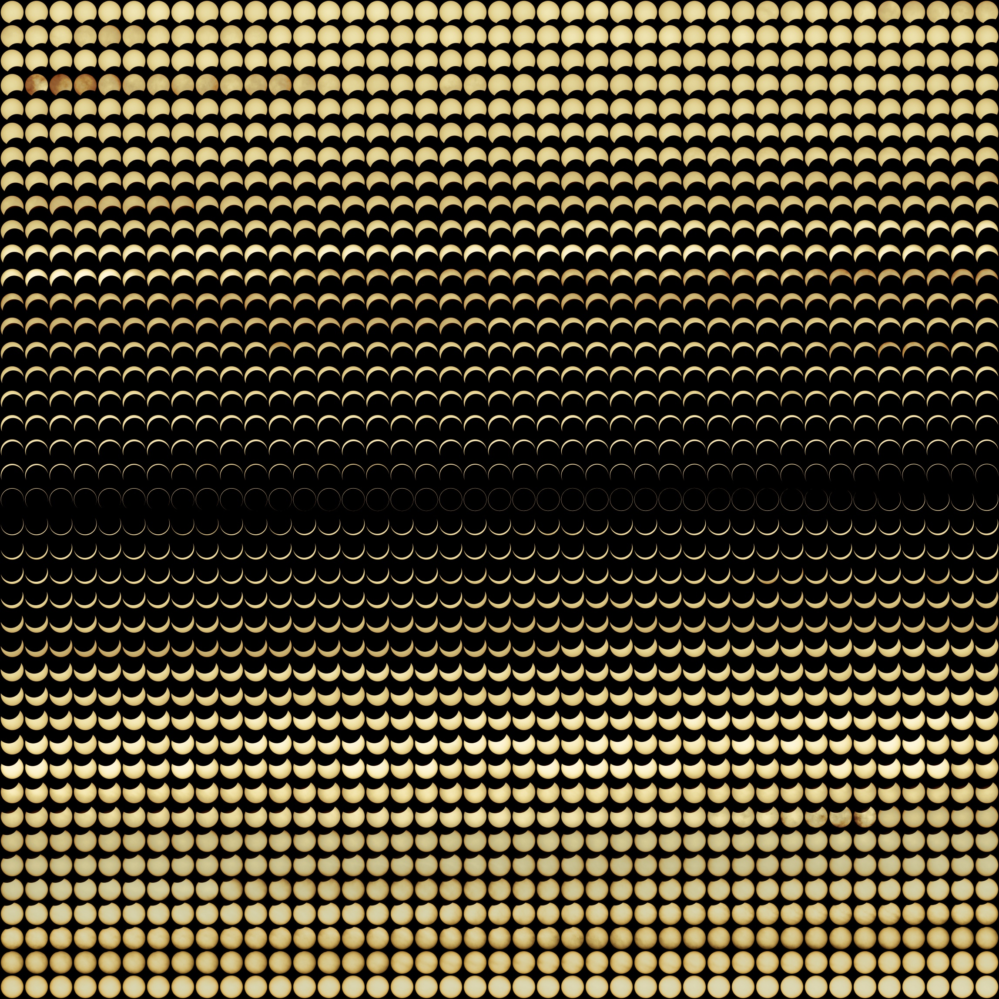
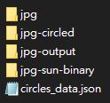
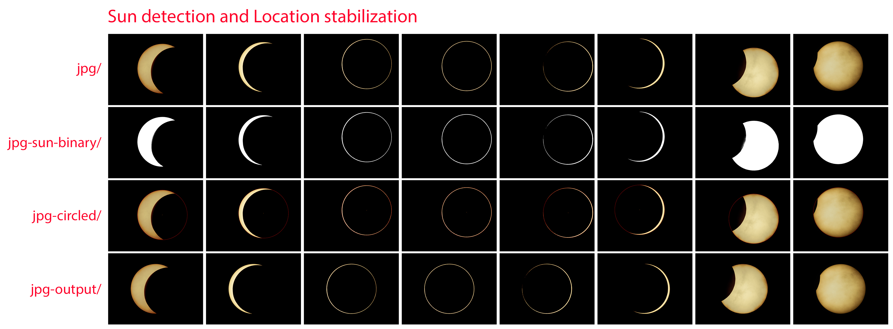
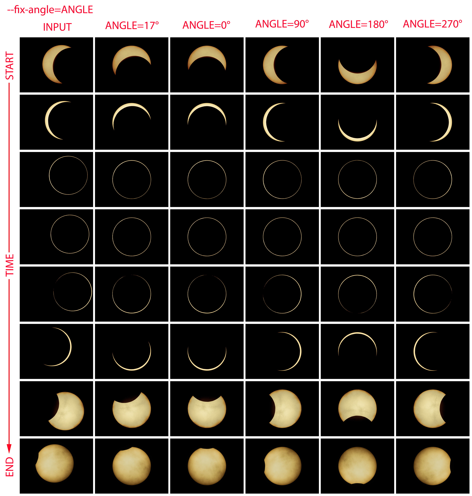
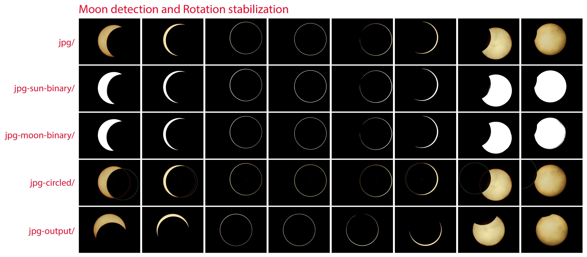

# Solar Eclipse Timelapse Aligner

[](https://github.com/hotdogee/solar-eclipse-timelapse-aligner/actions/workflows/ci.yml)
[](https://github.com/hotdogee/solar-eclipse-timelapse-aligner/releases/latest)
[](LICENSE)

[](https://www.paypal.com/cgi-bin/webscr?cmd=_donations&business=hotdogee@gmail.com&lc=US&item_name=Solar+eclipse+timelapse+aligner+Development+Support&no_note=0&cn=&currency_code=USD&bn=PP-DonationsBF:btn_donateCC_LG.gif:NonHosted)

This specialized program is used to align and stabilize solar eclipse time-lapse photos. It was originally developed to process images of the 2020/6/21 annular solar eclipse taken from a Nikon P950 at a 2 second interval. The eclipse images I took had a black background with no details and a smooth surface sun with also no high contrast features for general image stabilization methods to match across the images. This program detects the location of the sun in the input images and saves a new image in the output directory with the sun moved to the center of the image, and can optionally rotate the images so that the moon enters from the same angle.

> [!NOTE]
> If your solar images were taken with a narrow band Ha filter, your images will likely have enough details for general stabilization methods to work.



## Before and after

| Before stabilization (YouTube) | After stabilization (YouTube) |
| --- | --- |
| [](https://youtu.be/71vtskpdcXA) | [](https://youtu.be/M4H9w8yh4Fg) |

## Features

* **Location stabilization:** Outputs new images with the sun moved to the center of the image.
* **Rotation stabilization:** Outputs new images with the sun moved to the center of the image and rotated so that the moon enters from the same angle.
* **Multi-core CPU support:** Will estimate the number of processes to use using the detected available memory and number of real CPU cores.
* Detects the center coordinates of the sun and the moon, the results are saved in a JSON file that can be reused.
* Detects the radius of the sun given a full sun image.
* Command line interface to manually fine-tune the detection parameters if the defaults are not perfect.

## Quick start

### Option 1: Run the executable (Windows 64-bit)

1. Download the latest `solar-eclipse-timelapse-aligner-*-windows-x64.zip` from the [releases page](https://github.com/hotdogee/solar-eclipse-timelapse-aligner/releases/latest).
2. Unzip the downloaded file, there should be a bat file named `start-cmd.bat` and a directory named `eclipse-aligner` with the exe `eclipse-aligner.exe` and a bunch of other files required by the exe inside.
   * NOTE: The exe needs to be located together with the other files inside the `eclipse-aligner` directory to work, if you want to move the exe to a different location, you need to move the whole directory.
3. Open Command Prompt or PowerShell and navigate to the `eclipse-aligner` directory inside the unzipped files.
   * TIP: For your convenience, you can also double click on `start-cmd.bat` to open up Command Prompt inside the `eclipse-aligner` directory.
4. Run `eclipse-aligner.exe -h` to print the full help. In PowerShell, add `.\` in front of the exe: `.\eclipse-aligner.exe -h`.

> [!IMPORTANT]
> The v1.0 executable has the bugs listed under [Troubleshooting](#troubleshooting). They are fixed on `master` and in releases newer than v1.0, or you can run the Python source code below.

### Option 2: Run the Python source code (Windows, macOS, Linux)

If you are comfortable working with Python (3.10 to 3.14), you can clone the project, pip install the requirements, and directly run the source code.

```bash
# Clone this repo
git clone https://github.com/hotdogee/solar-eclipse-timelapse-aligner.git
cd solar-eclipse-timelapse-aligner
# Optionally create and activate a new virtual environment
python -m venv .venv
source .venv/bin/activate        # Windows: .venv\Scripts\activate
# Install the required packages
pip install -r requirements.txt
# Print the full help message
python eclipse-aligner.py -h
```

In the examples below, replace `eclipse-aligner.exe` with `python eclipse-aligner.py` when running the source code.

### Try the examples

The [`examples`](examples) directory has three small image sets to check that everything works and to learn what results to expect:

```bash
python eclipse-aligner.py --input=examples/example0 --sun=examples/example0/ring.jpg
python eclipse-aligner.py --input=examples/example1 --sun_radius=110
python eclipse-aligner.py --input=examples/example2 --sun_radius=141 --sun_threshold=75
```

Each command saves the results next to the input directory (`examples/example1-output`, `examples/example1-circled`, ...) and the detected coordinates to `examples/circles_data.json`, which should contain these values (the order of the filenames does not matter):

| Example | Images | Expected `circles_data.json` |
| --- | --- | --- |
| `example0` | annularity, sun radius detected from `ring.jpg` | `{"ring.jpg": {"sun": [240, 180, 127]}}` |
| `example1` | partial phases, 416x312 crops | `{"ex1.jpg": {"sun": [238, 153, 110]}, "ex2.jpg": {"sun": [251, 147, 110]}, "ex3.jpg": {"sun": [276, 132, 110]}, "ex4.jpg": {"sun": [284, 140, 110]}, "ex5.jpg": {"sun": [302, 144, 110]}, "ex6.jpg": {"sun": [189, 131, 110]}}` |
| `example2` | 2024 eclipse photos from #5, small sun in a large frame, the threshold matters | `{"DSC05686.jpg": {"sun": [713, 1099, 141]}, "DSC05688.jpg": {"sun": [1382, 1166, 141]}, "DSC05690.jpg": {"sun": [1569, 1360, 141]}, "DSC05702.jpg": {"sun": [477, 1539, 141]}, "DSC05703.jpg": {"sun": [544, 1549, 141]}, "DSC05704.jpg": {"sun": [653, 919, 141]}}` |

## Input image requirements

Sun detection and sun centering works best if your images meet the following requirements:

1. Needs to be images of a solar eclipse in JPG format.
2. Images need to have clean dark backgrounds.
3. The sun needs to have clean edges when the program converts the image into black and white with a given threshold.
4. The size (in pixels) of the sun in the images needs to be constant, this should be true unless you changed the focal length during the shooting session.
5. The sun should be fully visible in all images, in other words, it should not be partially cut off at the edges. This program has a clipped sun filter, when enabled, will filter out images with edge pixels over a certain brightness level.
6. (Optional) For the auto sun radius detect feature, a photo of the sun where the sun is clear of clouds and mostly or completely un-eclipsed is used, this is usually the first or last clear photo in the shooting session, a full sun with no clouds works best.

Moon detection and moon angle stabilization currently only works if your images meet the following additional requirements:

1. The photos need to be taken at a location where the moon passes through the center of the sun, in other words, the eclipse needs to be a total solar eclipse or an annular solar eclipse. Partial solar eclipse images will not work with angle stabilization (centering should be fine).
2. When the images are sorted by filename, they should be in the correct chronological order.

## Workflow

1. (Optional) Run the [examples](#try-the-examples) to learn what results you should expect.
2. (Recommended) Pick a couple images (3 to 10) representative of the different stages of the eclipse, and process them with the program to quickly find a set of parameters that work well with all of the representative images.
3. Use the same parameters found in step 2 to process the full image set, if the results are not perfect, use the images that had incorrect detection to fine tune the parameters.

## Usage

This program currently only has a command line interface.

### Sun detection and location stabilization

1. `--input` Copy your eclipse images in JPG format to a new input directory. Develop your RAW images into JPGs first if you shot RAW.

2. `--sun` Start by letting the program auto detect the sun radius, choose one of the photos in the input directory where the sun is clear of clouds and mostly or completely un-eclipsed, this is usually the first or last clear photo in the shooting session, a full sun with no clouds works best.

   `--sun_radius` You can also directly provide the sun radius in pixels to fine-tune the sun coordinate detection if the results are not perfect, or if the radius can not be detected (see [Troubleshooting](#the-sun-radius-is-detected-as-0-or-is-too-small)).

3. For example, if I put the 8 example images inside `D:\eclipse\jpg` and use `D:\eclipse\jpg\DSCN3815.jpg` as the `--sun` image, I would run the following command:

    ```
    eclipse-aligner.exe --input=D:\eclipse\jpg --sun=D:\eclipse\jpg\DSCN3815.jpg
    ```

    and receive something like the following output:

    ```
    INFO: 8 images found in D:\eclipse\jpg
    INFO: Detected image size (height, width): (3456, 4608)
    INFO: Detected SUN RADIUS: 1210
    INFO: Starting 8 workers.
    Processing: 100%|############################| 8/8 [00:02<00:00,  3.58img/s]
        Saving: 100%|############################| 8/8 [00:04<00:00,  1.99img/s]
    ```

    Three new directories with suffixes `-circled`, `-output`, and `-sun-binary` and one new JSON file named `circles_data.json` will be created alongside the input directory:

    
    

4. Check the resulting centered images inside the `-output` directory. The directory will be created alongside the `--input` directory, for example, if your input directory is `./jpg`, the `-output` directory will be at `./jpg-output`.

5. If the results are not perfect, fine-tuning a few parameters may fix the problem. Start the fine-tuning process by viewing the images inside the `-circled` directory. The red circle represents the detected sun location, if the circles are off, follow the steps for [fine-tuning the sun detection](#fine-tuning-the-sun-detection) below.

### Clipped sun filter

* `--filter` will enable the clipped sun filter, when enabled, clipped and empty images will be moved to a directory with the same name as the input directory appended with `-clipped` by default. For example, if your input directory is `./jpg`, the images will be moved to `./jpg-clipped`. Each moved image is listed in the output.
* `--clipped_cutoff` (default: 40) and `--empty_cutoff` (default: 80) control which images are considered clipped (any edge pixel brighter than the cutoff) and empty (no pixel brighter than the cutoff).
* Example command:
  ```
  eclipse-aligner.exe --filter --input=D:\eclipse\jpg --sun=D:\eclipse\jpg\DSCN3815.jpg
  ```

### Fine-tuning the sun detection

1. Check the images inside the `-circled` directory, if the red circle looks larger or smaller than the actual sun, decrease or increase the `--sun_radius` and re-process the images. If you used the auto sun detection argument `--sun` you can find the detected sun radius in the output `INFO: Detected SUN RADIUS: 1210` and start fine-tuning from that value.

2. If the size of the red circle looks good, but the location is off, check the images inside the `-sun-binary` directory, and see if there are any images with fuzzy sun edges, increase or decrease the `--sun_threshold` (default: 25) until the edges of the sun are nice and clean like the example. `example2` is a case where the default threshold picks up too much glow around the sun and `--sun_threshold=75` works better.

* Example command:
  ```
  eclipse-aligner.exe --input=D:\eclipse\jpg --sun_radius=1210 --sun_threshold=25
  ```

### Moon detection and rotation stabilization

NOTE: Only works for total solar eclipse or annular solar eclipse, this part of the program assumes that the center of the moon passes through the center of the sun at the maximum point in your images.
Use this feature if after viewing the results of sun centering, you determine that the rotation of the sun also needs to be fixed.

1. `--fix_angle` Enables moon angle stabilization and rotates the output images so that the moon moves along the same direction in every image. Set a value between `0` and `359` in degrees, check the image below for examples when this argument is set to `0`, `90`, `180`, and `270`.
   

2. `--moon_radius_mod` (MOON_RADIUS - SUN_RADIUS) in pixels, use a negative value if the moon is smaller than the sun (as is the case of annular solar eclipse). There is currently no auto-detect feature for the moon radius, use Photoshop or similar software to figure out how much larger or smaller in pixels is the moon when compared to the sun. For example, if the width of the moon is 2372, the moon radius would be 1186, and if the sun radius is 1210, set `--moon_radius_mod` to -24 (because 1186 - 1210 = -24).

3. Check the resulting centered images inside the `-output` directory.

4. If the results are not perfect, fine-tuning a few parameters may fix the problem. Start the fine-tuning process by viewing the images inside the `-circled` directory. The red circle represents the detected sun location, the green circle represents the detected moon location, if the moon circles are off, follow the steps for [fine-tuning the moon detection](#fine-tuning-the-moon-detection) below.

* Example command:
  ```
  eclipse-aligner.exe --input=D:\eclipse\jpg --sun=D:\eclipse\jpg\DSCN3815.jpg --fix_angle=17 --moon_radius_mod=-24
  ```
  Output:
  ```
  INFO: 8 images found in E:\test3\jpg
  INFO: Detected image size (height, width): (3456, 4608)
  INFO: Detected SUN RADIUS: 1210
  INFO: Using MOON RADIUS: 1186 (sun_radius + moon_radius_mod)
  INFO: Starting 8 workers.
  Processing: 100%  %|############################| 8/8  [01:30<00:00, 11.27s/img]
      Saving: 100%  %|############################|  8/8 [00:04<00:00,  1.74img/s]
  ```
  Result:
  

### Fine-tuning the moon detection

Moon detection errors for images taken near totality or annularity and near the start or end of the eclipse can be safely ignored. To solve the problem that the angle of moon is ambiguous at totality or annularity, we group the images where the distance of the sun and moon is smaller than the `--max_phase_rotation_group_threshold` (default: 30 pixels), and assume that the required rotation is the same for the whole group, and the required rotation of the image with a distance just greater than the given value is used for the whole group. Moon detection for images near the start or end of the eclipse may be hard to get right, we group the images where the shadowed width is less than the `--min_phase_rotation_group_threshold` (default: 100 pixels), and assume that the required rotation is the same for the images in the same group.

1. Try smaller or larger values of `--moon_radius_mod` until the size of the green circle of images inside the `-circled` directory best matches the moon's shadow in the image.

2. Check the images inside the `-moon-binary` directory, and see if there are any images with fuzzy moon edges, increase or decrease the `--moon_threshold_mod` (default: -1) until the edges of the moon are nice and clean like the example.

### Reusing the detected coordinates

The detected sun and moon coordinates are saved to `circles_data.json` alongside the input directory, and the file is overwritten on every run. If the detected locations are good, you can move the file to another location and pass it with `--circles` to skip the detection, for example if you decide to re-develop the DNGs with better settings. If the `--circles` file does not exist, the program asks whether to run the detection and save the results to that file.

```
eclipse-aligner.exe --input=D:\eclipse\jpg --sun_radius=1210 --circles=D:\eclipse\good_circles_data.json
```

## Options

| Option | Default | Description |
| --- | --- | --- |
| `--input INPUT` | required | Directory with the input JPGs, develop your RAW/DNG images into JPGs first. |
| `--sun SUN` | | Image with an un-eclipsed (or the least eclipsed) sun, used to detect the sun radius. |
| `--sun_radius SUN_RADIUS` | | Radius of the sun in pixels, use instead of `--sun`. |
| `--sun_threshold SUN_THRESHOLD` | `25` | Brightness threshold used to convert the image to black and white, choose a value that gives clean sun edges. |
| `--fix_angle FIX_ANGLE` | `-1` (off) | Enables moon angle stabilization and rotates the output so the moon moves along this angle in degrees. Do not enable for partial solar eclipses. |
| `--moon_radius_mod MOON_RADIUS_MOD` | `-24` | MOON_RADIUS - SUN_RADIUS in pixels, negative if the moon is smaller than the sun (annular eclipse). |
| `--moon_threshold_mod MOON_THRESHOLD_MOD` | `-1` | Added to the dynamic Otsu threshold used for moon detection, choose a value that gives clean moon edges. |
| `--max_phase_rotation_group_threshold THRESHOLD` | `30` | Images with a sun-moon distance below this (in pixels) reuse the rotation of the previous image. |
| `--min_phase_rotation_group_threshold THRESHOLD` | `100` | Images where the shadowed width is less than this (in pixels) reuse the rotation of the previous image. |
| `--filter` | off | Enables the clipped sun filter. |
| `--clipped_cutoff CLIPPED_CUTOFF` | `40` | The filter moves images where any edge pixel is brighter than this. |
| `--empty_cutoff EMPTY_CUTOFF` | `80` | The filter moves images where no pixel is brighter than this. |
| `--workers WORKERS` | `-1` (auto) | Number of worker processes, each worker requires about 3.5GB of RAM for 16M pixel images, the larger the image the more RAM is required. |
| `--output_suffix`, `--clipped_suffix`, `--circled_suffix`, `--sun_binary_suffix`, `--moon_binary_suffix` | `-output`, `-clipped`, `-circled`, `-sun-binary`, `-moon-binary` | Suffixes of the result directories created alongside the input directory. |
| `--circles CIRCLES` | `circles_data.json` alongside the input directory | Reuse the sun and moon coordinates in this JSON file instead of detecting them, see [above](#reusing-the-detected-coordinates). |

<details>
<summary>Complete <code>eclipse-aligner -h</code> output</summary>

```
usage: eclipse-aligner [-h] [-v] --input INPUT [--sun SUN] [--sun_radius SUN_RADIUS]
                       [--sun_threshold SUN_THRESHOLD] [--fix_angle FIX_ANGLE]
                       [--moon_radius_mod MOON_RADIUS_MOD]
                       [--moon_threshold_mod MOON_THRESHOLD_MOD]
                       [--max_phase_rotation_group_threshold THRESHOLD]
                       [--min_phase_rotation_group_threshold THRESHOLD] [--filter]
                       [--clipped_cutoff CLIPPED_CUTOFF] [--empty_cutoff EMPTY_CUTOFF]
                       [--workers WORKERS] [--output_suffix OUTPUT_SUFFIX]
                       [--clipped_suffix CLIPPED_SUFFIX] [--circled_suffix CIRCLED_SUFFIX]
                       [--sun_binary_suffix SUN_BINARY_SUFFIX]
                       [--moon_binary_suffix MOON_BINARY_SUFFIX] [--circles CIRCLES]

This specialized program is used to align and stabilize solar eclipse time-lapse photos

options:
  -h, --help            show this help message and exit
  -v, --version         show program's version number and exit
  --input INPUT         Path to the input directory, will only read JPGs, develop you DNGs into
                        JPGs first.
  --sun SUN             Path to an image with an un-eclipsed sun, used to auto detect the radius
                        of the sun in pixels, if you do not have an image with an un-eclipsed sun,
                        you can try using an image with the least partially eclipsed sun.
  --sun_radius SUN_RADIUS
                        Radius of the sun in pixels, if not given, auto detect from full sun
                        image. (default: -1)
  --sun_threshold SUN_THRESHOLD
                        Brightness threshold used to convert the image to black and white, choose
                        a value that gives clean edges for best results. (default: 25)
  --fix_angle FIX_ANGLE
                        Rotates the outputted images. Enables moon angle stabilization if given a
                        non-negative value in degrees, do not enable if processing partial solar
                        eclipse images. (default: -1)
  --moon_radius_mod MOON_RADIUS_MOD
                        (MOON_RADIUS - SUN_RADIUS) in pixels, use a negative value if the moon is
                        smaller than the sun (as is the case of annular solar eclipse). (default:
                        -24)
  --moon_threshold_mod MOON_THRESHOLD_MOD
                        Use a negative value to use a smaller threshold, or a positive value to
                        use a larger threshold, choose a value that gives clean moon edges.
                        TECHNICAL INFO: this value is added the dynamic Otsu threshold. (default:
                        -1)
  --max_phase_rotation_group_threshold THRESHOLD
                        To solve the problem that the angle of moon is ambiguous at totality or
                        annularity, we group the images where the distance of the sun and moon is
                        smaller than the given value in pixels, and assume that the require
                        rotation if the same for the whole group, and the required rotation of the
                        image with a distance just greater than the given value is used for the
                        whole group. (default: 30)
  --min_phase_rotation_group_threshold THRESHOLD
                        Moon detection for images near the start or end of the eclipse may be hard
                        to get right, we group the images where the shadowed width is less than
                        the given value in pixels, and assume that the require rotation if the
                        same for the images in the same group. (default: 100)
  --filter              Enable the clipped sun filter. (default: False)
  --clipped_cutoff CLIPPED_CUTOFF
                        The clipped sun filter will filter out images if any edge pixel's
                        brightness exceeds this value. (default: 40)
  --empty_cutoff EMPTY_CUTOFF
                        The clipped sun filter will filter out images if the brightest pixel in
                        the image is lower than this value, in other words, there is nothing in
                        the image. (default: 80)
  --workers WORKERS     Number of processing workers, each workers requires 3.5GB of RAM for 16M
                        pixel images, the larger the image the more ram is required. (default: -1)
  --output_suffix OUTPUT_SUFFIX
                        The stabilized results will be save to a directory with the same name as
                        the input directory appended with the given suffix. (default: -output)
  --clipped_suffix CLIPPED_SUFFIX
                        The clipped sun filer will move images to a directory with the same name
                        as the input directory appended with the given suffix. (default: -clipped)
  --circled_suffix CIRCLED_SUFFIX
                        Images with the sun circled in red for validation will be saved to a
                        directory with the same name as the input directory appended with the
                        given suffix. (default: -circled)
  --sun_binary_suffix SUN_BINARY_SUFFIX
                        Black and white images using the sun threshold will be saved to a
                        directory with the same name as the input directory appended with the
                        given suffix. Used for finetuning the sun threshold value. (default: -sun-
                        binary)
  --moon_binary_suffix MOON_BINARY_SUFFIX
                        Black and white images using the moon threshold mod will be saved to a
                        directory with the same name as the input directory appended with the
                        given suffix. Used for finetuning the moon threshold mod value. (default:
                        -moon-binary)
  --circles CIRCLES     If not given, by default, the program will save the detected sun and moon
                        location data in JSON format to a file named circles_data.json located in
                        the same directory as the input directory, and will overwrite the file if
                        exists. If the detected location are good, you can choose to move the file
                        to another location for reuse if you decide to re-develop the DNGs with
                        better settings. If given the path to the existing good circles_data.json,
                        the program will read the sun and moon location data from the JSON file
                        and perform the centering and angle stabilization using the data in the
                        JSON file. (default: circles_data.json)
```

</details>

## Troubleshooting

### The sun radius is detected as 0 or is too small

`INFO: Detected SUN RADIUS: 0` (or 1, 2, ...) followed by an `OpenCV ... (-215:Assertion failed) radius >= 0 ... in function 'circle'` error ([#4](https://github.com/hotdogee/solar-eclipse-timelapse-aligner/issues/4)).

* v1.0 measured the first bright spot it found instead of the sun, so a single noisy pixel above the sun gave a radius of 0. The detection now uses the largest bright object, preferring objects that do not touch the image border.
* v1.0 also required a sun radius larger than 50 pixels, smaller suns are now supported, no need to resize your images.
* If the detection still fails, the program exits with an error. Try a `--sun` image with a clear and mostly un-eclipsed sun, adjust `--sun_threshold` until the sun has clean edges in the black and white image, or measure the radius yourself and pass it with `--sun_radius`: open the image in an image editor, find the pixel coordinates of the two ends of a diameter of the sun, and divide the distance between them by 2.

### `ValueError: index can't contain negative values`

Raised by `np.pad` in v1.0 when the sun is small compared to the image size ([#3](https://github.com/hotdogee/solar-eclipse-timelapse-aligner/issues/3)). The centering no longer pads the image to a canvas based on the sun size, so this is fixed for both sun centering and `--fix_angle`. The `canvas_size = max(img_h, img_w)` workaround from the issue is no longer needed (and it broke the moon detection used by `--fix_angle`).

### The program hangs at `Processing: 0%`

With `--filter`, v1.0 waited forever on Linux (or stopped with `name 'jpg_clipped_path' is not defined` on Windows and macOS) as soon as one image was moved to the `-clipped` directory ([#6](https://github.com/hotdogee/solar-eclipse-timelapse-aligner/issues/6)). The moved images are now listed in the output and left out of the results. If a worker process fails or crashes (for example when it runs out of memory), the program now stops with an error message and exit status 1 instead of waiting. If you run out of memory, use fewer `--workers`.

### `pip install -r requirements.txt` fails

Use a 64-bit Python 3.10 to 3.14, pip picks the newest numpy, scipy and OpenCV releases that support your Python version. On older Python versions, upgrade Python or install the packages in `requirements.txt` one by one.

## Development

```bash
pip install -r requirements-dev.txt
# lint (syntax errors and undefined names)
ruff check .
# run the tests (about 30 seconds)
python -m pytest
```

* The tests in [`tests`](tests) generate synthetic eclipse frames (a bright sun disk and a dark moon disk at varying offsets and sizes) and run the command line program on them and on the `examples` in a temporary directory, including regression tests for [#3](https://github.com/hotdogee/solar-eclipse-timelapse-aligner/issues/3), [#4](https://github.com/hotdogee/solar-eclipse-timelapse-aligner/issues/4), [#6](https://github.com/hotdogee/solar-eclipse-timelapse-aligner/issues/6) and `--fix_angle`.
* [CI](.github/workflows/ci.yml) runs the linters and the tests on Linux, Windows and macOS with Python 3.10 to 3.14, and once with the lowest dependency versions allowed by `requirements.txt`.
* To build the Windows executable locally, run `pyinstaller --noconfirm eclipse-aligner.spec` on Windows, the result is in `dist/eclipse-aligner`.
* To release, update the version in `eclipse-aligner.py` and push a tag like `v1.1`. The [release workflow](.github/workflows/release.yml) builds and tests the Windows executable and attaches the zip to a draft GitHub Release, review the notes and publish it.

## Credits

* Created by Han Lin ([@hotdogee](https://github.com/hotdogee)).
* Thanks to Elizabeth Patitsas ([@patitsas](https://github.com/patitsas)) for [#5](https://github.com/hotdogee/solar-eclipse-timelapse-aligner/pull/5): the sun radius error messages, the first canvas size fix, the example image sets, and the documentation improvements.
* Thanks to [@dmcrlsn](https://github.com/dmcrlsn) for the canvas size workaround in [#3](https://github.com/hotdogee/solar-eclipse-timelapse-aligner/issues/3) ([Cloudy Nights post](https://www.cloudynights.com/topic/895254-imppg-align-annular-eclipse/?p=13012539)), [@setnes](https://github.com/setnes) for noticing how it interacts with `--fix_angle`, [@chvvkumar](https://github.com/chvvkumar) for the executable build instructions, and everyone who reported issues.

## Contribute

Pull requests for bug fixes and new features are welcome!

## Donations

If this project has helped you save some time, you can give me a cup of coffee :)

[](https://www.paypal.com/cgi-bin/webscr?cmd=_donations&business=hotdogee@gmail.com&lc=US&item_name=Solar+eclipse+timelapse+aligner+Development+Support&no_note=0&cn=&currency_code=USD&bn=PP-DonationsBF:btn_donateCC_LG.gif:NonHosted)

## License

[MIT](LICENSE)
